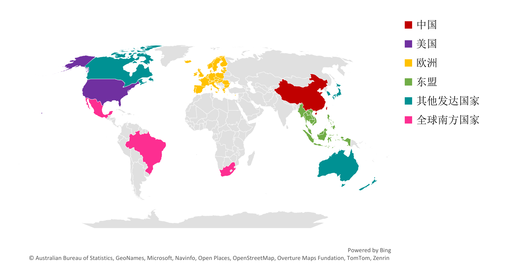



  <h3 class="university">The Hong Kong Polytechic University</h3>
  
  

    2026
  

  
  

    <ul>
      <li><i class="fas fa-check-circle"></i> Responsible for developing a global spatial database of electric vehicle charging stations (EVCS), including the collection, cleaning, and standardization of multi-source datasets from OpenStreetMap, national statistical agencies, gridded renewable energy datasets, and other sources.</li>
      <li><i class="fas fa-check-circle"></i> Responsible for computational modeling and thematic mapping of public EVCS spatial distribution, including spatial clustering, coverage metrics, and spatial overlay analyses with socioeconomic and land-use data, as well as sustainability assessments covering accessibility, spatial equity, and suitability for wind and solar energy integration.</li>
    </ul>
  

## Executive Summary

<!-- This report presents a quantitative comparative analysis of six major study regions, drawing on public electric vehicle charging station location data from 54 countries and regions in 2025, electric vehicle market statistics from the International Energy Agency (IEA) spanning 2015–2025, population and point-of-interest (POI) spatial datasets, gridded wind and solar energy resources, and user reviews from China, the United States, and Europe collected in 2024.

The analysis examines EV market trends, spatial distribution patterns, accessibility and spatial equity, renewable energy integration, and user experience. Based on these findings, the report identifies key policy implications for the development of sustainable and equitable EV charging infrastructure. -->

The six study regions are defined as follows:

1. **United States**
2. **Europe:** 32 countries, including the 27 European Union (EU) member states, the United Kingdom, and the four member states of the European Free Trade Association (EFTA): Iceland, Liechtenstein, Norway, and Switzerland.
3. **China:** Including Mainland China, Hong Kong, Macau, and Taiwan.
4. **Other Developed Countries:** Canada, Japan, South Korea, New Zealand, and Australia.
5. **ASEAN:** 10 Southeast Asian countries, excluding Timor-Leste from the 11 ASEAN member states.
6. **Global South Countries:** Mexico, South Africa, and Brazil.

## Download

- [Global Public EV Charging Infrastructure Annual Report 2026 (Coming Soon)](#)