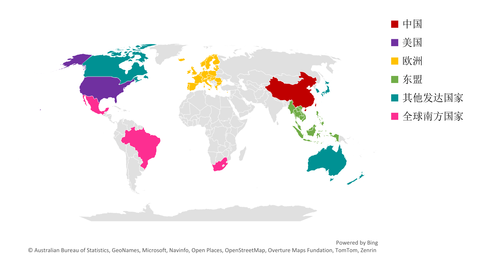



  <h3 class="university">香港理工大学</h3>
  
  

    2026年
  

  
  

    <ul>
      <li><i class="fas fa-check-circle"></i> 负责建设全球电动汽车充电设施（EVCS）空间数据库，完成多源数据（包括OpenStreetMap、各国统计机构、可再生能源网格数据等）的收集、清洗与标准化处理；</li>
      <li><i class="fas fa-check-circle"></i> 负责公共充电站空间分布分析（含聚集度、覆盖度指标测算及其与社会经济、土地利用关系的空间叠置）和可持续性评估（含可达性评估、空间公平性评估及风光潜能适配性评估）的计算建模与专题图编制。</li>
    </ul>
  

## 摘要

本报告基于2025年全球54个国家或地区的公共充电站位置数据、2015—2025年国际能源署电动汽车市场数据、人口与兴趣点空间数据、风光资源栅格以及 2024 年中美欧用户评论，从市场追踪、空间分布、可达性与公平性、可再生能源协同和用户体验等角度，对六大研究区域进行量化比较，并据此提出政策启示:

（1）美国；
（2）欧洲：32国，含27个欧盟成员国、英国、以及欧洲自由贸易联盟（EFTA）的四个成员国即冰岛、列支敦士登、挪威、瑞士；
（3）中国，含中国大陆、香港、澳门和台湾；
（4）其他发达国家：包括加拿大、日本、韩国、新西兰和澳大利亚；
（5）东盟10 国（东盟 11国中不含东帝汶）；
（6）全球南方国家：墨西哥、南非、巴西。

## 下载连接

- [2026年全球电动汽车充电基础设施年度报告（尽情期待）](#)
